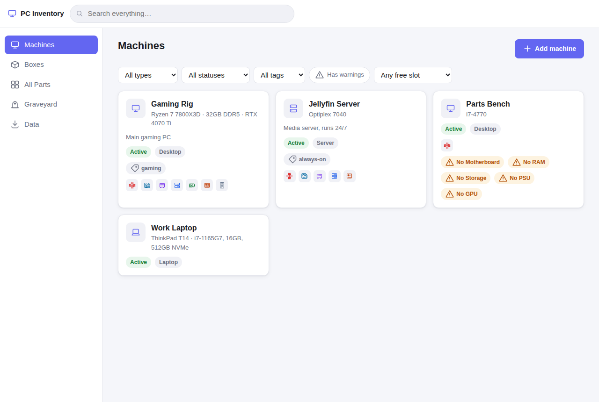
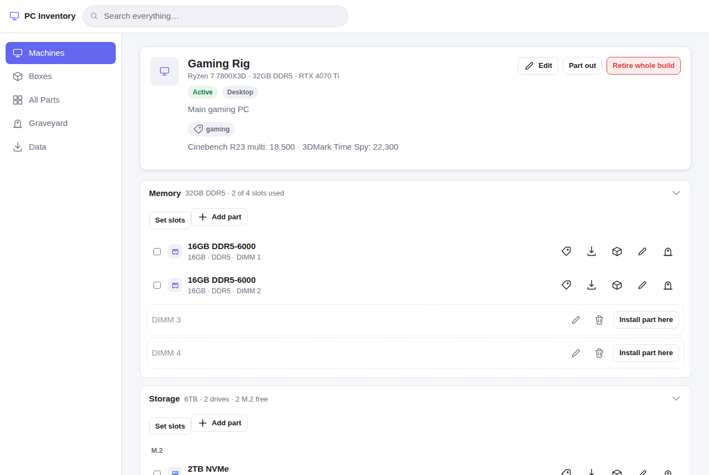

# PC Inventory

A fully static web app for tracking the computers, parts, and boxes of spare hardware scattered around your house — what's built into which machine, what's sitting in a box, and what's been retired. Everything lives in your browser (no server, no account); JSON export/import is your backup. Live app once deployed: **`https://<your-username>.github.io/pc-inventory/`** (update this link after enabling GitHub Pages — see [Deploying](#deploying)).




[PCparts](https://dafioram.github.io/PCparts/)

## Features

- **Builds vs. devices vs. boxes.** Custom desktops/servers ("builds") track individual parts; laptops/mini-PCs/SBCs ("devices") are tracked as a single item with a free-text specs line. Boxes are storage locations — parts that aren't installed anywhere live in the always-present **Unused** box or a named box of your own.
- **Per-slot RAM, storage, and PCIe tracking.** Set up DIMM/M.2/SATA/PCIe slot counts per build; parts auto-assign to the first free compatible slot, auto-split when you add a quantity > 1, and overflow gracefully (with a toast and undo) if you install more than you've defined slots for. Slots can be relabeled or removed. A drive with no kind set gets asked "M.2 or SATA?" when it's installed.
- **Missing-part warnings.** A build missing a CPU, motherboard, RAM, storage, PSU, or GPU shows a warning, with a per-category "Integrated / not needed" override for builds that don't need one (e.g. a headless server with no GPU).
- **Part out vs. retire whole build.** Both show every part that will be affected before you confirm. Part out moves every part to a box you choose and deletes the build record; retiring a whole build retires every part together under one retirement group — for when the whole thing is being sold or scrapped as-is.
- **Graveyard.** Retired parts, retired devices, and whole-build retirement groups all live here, with reason, date, and price, filterable and separate from your active inventory.
- **Tags and search.** Tag machines, parts, and boxes; filter by tag; the search box finds machines, parts, and boxes by name, notes, details, or tag and shows where each part is. Searches live in the URL, so Back and reload keep them.
- **Undo.** Every change shows a toast with **Undo** for that change, and the **Undo** button in the top bar (or Ctrl/⌘+Z) steps back through up to 20 recent changes. History is in memory only and resets on reload.
- **Fix mistakes.** Edit any part, including its category while it's in a box; delete an entry made by mistake (retire things that actually left your hands, so they stay in the graveyard).
- **JSON backup.** Export your whole inventory as one JSON file at any time. A reminder banner appears when you have changes that haven't been backed up in two weeks. Importing replaces everything, but downloads an automatic backup of your current data first.

## Privacy and backups

This app never sends your data anywhere — there's no server and no account. Everything is stored in your browser's local storage, on your device only. **That means it can be lost**: browsers can clear site storage (especially if you don't visit the page for a while, run low on disk space, or clear browsing data). Export a backup regularly from the **Data** page, or from the reminder banner. Importing a file replaces all current data — a backup of what you had is downloaded automatically right before the replacement happens, so you can always undo an accidental import by re-importing that backup.

A few safety nets are built in:

- If the saved data ever can't be read (for example after a bad hand edit), the app keeps a copy of it before starting fresh and shows a banner to download it — it's never silently thrown away.
- If the browser blocks storage (some private modes), a banner says your changes won't be saved.
- If you have the app open in two tabs, each tab picks up the other's changes instead of overwriting them.

## How to use it

- **Add a machine** from the Machines page — choose Build (desktop/server, with slots and individual parts) or Device (laptop/mini-PC/SBC/other, tracked as one item).
- **Add parts** to a build from its detail page: RAM/storage/PCIe go in their own sections (with slots), everything else (CPU, motherboard, PSU, case, cooler, fans) goes under "Other parts". Parts not installed anywhere live in a box — add them from a box's page or the All Parts page.
- **Move parts** with the "Move to…" action on any part, between boxes and builds, one at a time or in bulk (tick several checkboxes first). In the picker you can type a name and press Enter.
- **Part out vs. retire:** use **Part out** on a build to disassemble it — every part moves to a box you pick, and the build record disappears. Use **Retire whole build** when the whole machine (case and all) is going away — every part is retired together and the build is deleted.
- **Retiring and restoring** a single part or device sends it to the **Graveyard**; restore it from there back into a box.
- **Notes** on a machine are a good place for extras like benchmark scores.
- **Keyboard:** `/` jumps to search, Esc closes dialogs (or clears the search box), Ctrl/⌘+Z undoes.
- **Import/export** live on the **Data** page — export any time, and see when you last exported and whether this browser is protected from automatic storage cleanup.

## Local development

No build step — it's plain ES modules. Serve the `app/` folder with any static file server, for example:

```sh
npx http-server app
```

Then open the URL it prints.

## Running tests

```sh
npm install
npm run test:unit        # unit tests (node:test): model, schema, storage, store
npm run test:e2e         # Playwright end-to-end tests, headless
npm run test:e2e:headed  # same, with a visible browser
npm test                 # unit tests, then e2e headless
E2E_SLOW=1 npm run test:e2e  # simulate a slow CI machine to shake out timing bugs
```

The first time, install the Playwright browsers with `npx playwright install --with-deps`. E2E tests run against Chromium, Firefox, WebKit, and a mobile-viewport Chromium project (see `playwright.config.js`). Unit tests live in `tests/unit/`, end-to-end tests in `tests/e2e/` (`regressions.spec.js` pins down specific bugs that were fixed), and sample import files in `tests/fixtures/`.

## Deploying

This repo deploys the `app/` folder to GitHub Pages automatically:

1. Push to `main` — `.github/workflows/test.yml` runs the unit and e2e test suites (headless and headed).
2. Once tests pass, `.github/workflows/deploy.yml` publishes `app/` to GitHub Pages. It only deploys pushes to `main` of this repository — never pull requests.
3. In the repo's **Settings → Pages**, set **Source** to **GitHub Actions** (one-time setup).

After the first successful deploy, update the live-app link at the top of this README with your Pages URL.

## JSON format

Exported files are a single JSON object: `{ app: "pc-inventory", schemaVersion, machines, boxes, parts, retirementGroups, meta }`. Full field-by-field rules and validation requirements are in [`SPEC.md` §11](SPEC.md#11-import-and-export).
